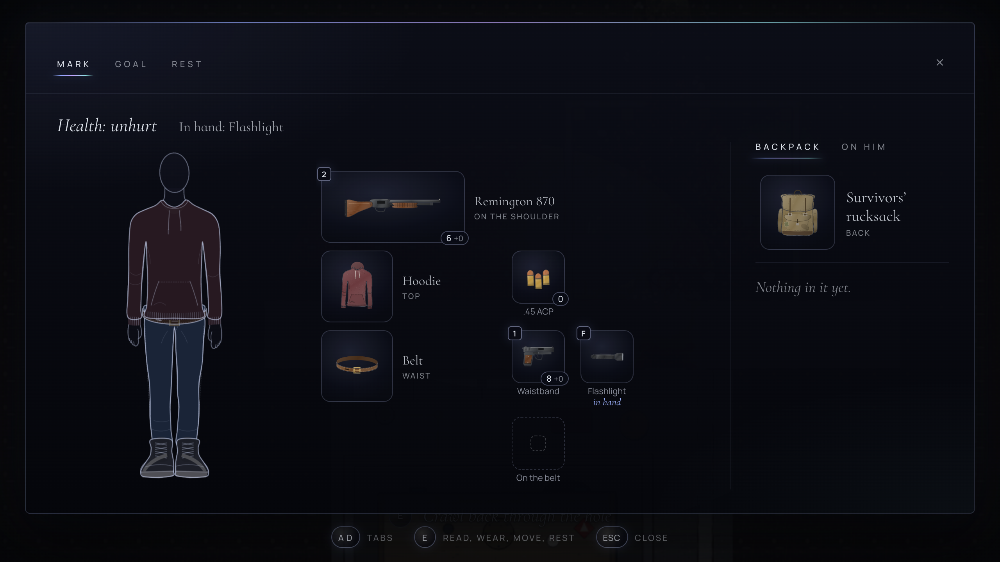

The [concept demo](https://play.mirrowick.com/) has changed again since our last post. Saves from before won’t load, so the game starts afresh once more.

The underground level now leads somewhere new. Past its edge there is a narrow crawl you can only get through bent low, and beyond it a few old rooms where someone lived before Mark. It is dark there, and this is where he now spends his first night. The lamps in the rooms can be lit and put out again, and what was left behind is worth a look.

What Mark wears matters now. His clothes decide how much he can keep about him and where, and a rucksack, once he finds one, carries the rest. It goes on his back, and he can take it off and leave it on the floor with everything in it until he comes back for it.

His window has been redone around his figure. You see him as he is dressed, and beside him each thing he wears and the places it gives him; an empty place is filled with a click. The pictures of things are larger now, and in colour.

The same clothes now show on Mark in the game itself. He is drawn a part at a time, like a paper doll, so whatever he puts on, down to the rucksack on his back, appears on him. There is also a map, which he sketches in pencil as he goes, with only what he has seen on it.

Behind this is a good deal of quiet work. Each piece of clothing is drawn once, as a plain white cut, and dyed its colour, so the window and the game share one picture of it. The map isn’t drawn by hand at all: it is built from the level itself and changes along with it. It is still a concept, not the game, and all of it may still change.
