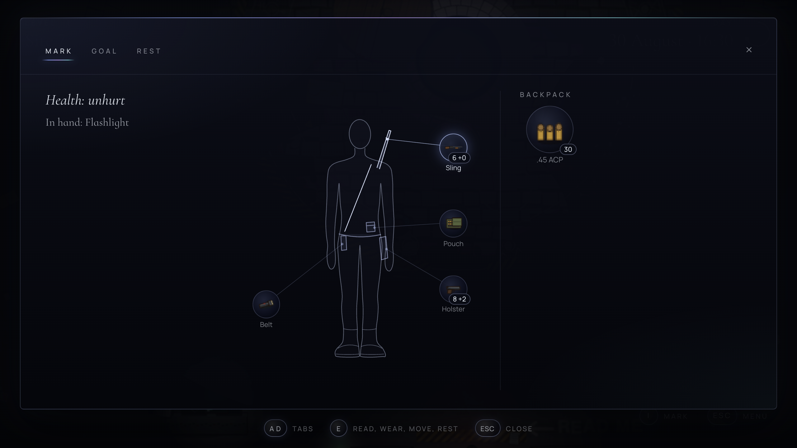
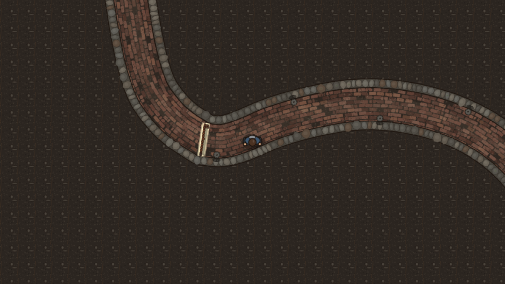
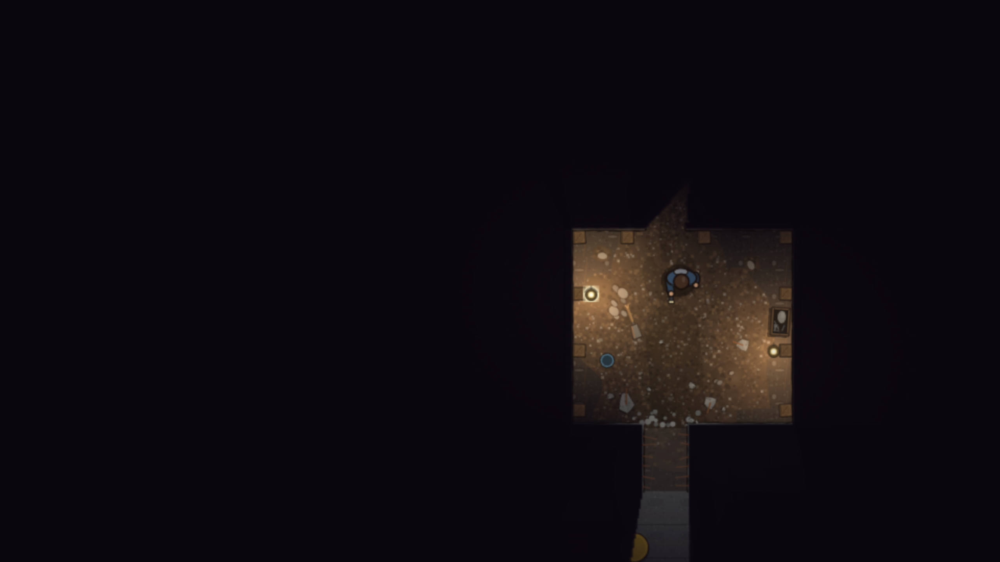

Since our last post the [concept demo](https://play.mirrowick.com/) has changed more than it looks at first: the hero now has a state, the day has hours, and the demo runs on past where it used to stop. It is still a concept, not the game.

**The hero**

- Press `I` for the Mark window. The game stands still behind it, and it has three tabs: Mark, Goal and Rest.
- Mark’s tab shows his figure, with what he wears and keeps to hand drawn on him, and the backpack beside it. A helmet and a vest show on the hero in the game too.
- Goal is one goal, told in a few lines from what he knows so far, so it should be clearer what to do next.
- A long gun, a pistol and the flashlight are to hand; everything else is in the backpack, and there is no getting at it while something hunts him.
- Mark is now Victor’s younger brother, not his nephew. His thoughts appear over his head.

**Time, food and sleep**

- Time is now a date and an hour, running five times faster than ours. Things take minutes: searching a locker costs five, and you see them go.
- Wounds don’t close on the move. Sitting down heals them, for anything from 15 minutes to 4 hours, when nothing is too close.
- Sleep is on a bunk on level −1, with its own scene the first night. Waking there gives you a point to start over from if you die.
- After that first sleep Mark needs food, water and rest. He eats and drinks by himself as long as he carries some. Without it he doesn’t die, he weakens, and thirst, hunger and tiredness each weaken him in a different way.
- The demo now ends at midnight after the third day, counting the day he first wakes. Survival mode opens then.

**Guns and things**

- Rounds go by calibre. Each gun has its magazine, spare ones sit in the pouches, and loose rounds in the backpack, which he can’t reach in a fight. He refills the pouches by himself when it is quiet and the gun is put away.
- Each gun has its own way of using the hands: a pistol leaves one for the flashlight, the M4 has a light of its own, and with the shotgun there is no light at all.
- `1` draws what is in the holster, `2` what is on the sling.
- What you find comes as a list to take or leave. Mark only picks up what he knows a use for, and remembers the rest.

**Saving**

- `Esc` now pauses the game under a menu.
- Foes placed by hand stay dead after you leave and come back; rooms that fill up with foes still fill up again. Wounds are kept when you quit.
- Old saves do not carry over: the demo starts afresh for everyone.

**Places and sound**

- Victor’s house, yard and furniture are at their true size, and the house is furnished like a real one.
- Behind a door in the cellar’s hall there is now a long brick passage in pitch dark, up to an iron gate rusted shut.

- The hole behind the drum on level −1 no longer ends the demo. Beyond it is a shored dugout with kerosene lamps, which need a lighter, and a crawl you can only get through bent double. Where it goes, you can see for yourself.
- Light stops at the face of a wall, and shots, sparks and glowing foes now throw the shadows of walls.
- New music: a theme for the title screen, a lazy summer day at the house, silence in the cellar, and a layer for a fight that thickens the closer they get and the more of them there are.

**How it was made**

We moved everything to true size, on a half-metre tile. The cars are the one exception, at 85%: seen from above, a real car beside a real man looks like a bus. Level −1 is now laid out from a single plan, where each room and each doorway is written down once and everything in a room is measured from its walls, so walls can move without changing numbers all over the code.

The game’s main scene had grown too large, so most of it moved out: light, targets, the hero, wounds, days and each place’s story now live on their own, and the scene only knows mechanics. Every item sits in one catalogue, one entry with all there is about it. The music is still built entirely in code, with no sound files.
