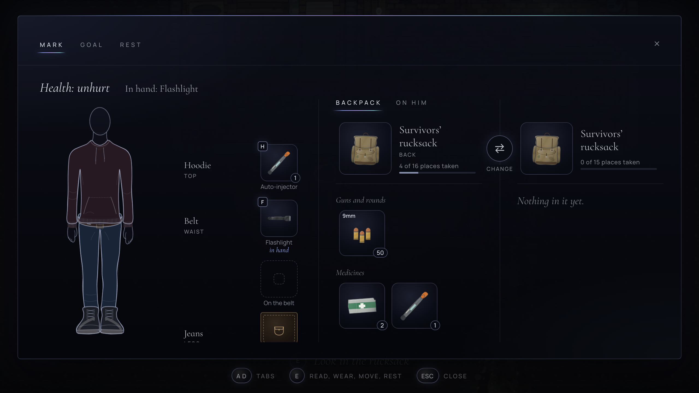

Since our last post the [concept demo](https://play.mirrowick.com/) has changed a good deal. Old saves won’t load this time either, so the game starts afresh.

Most of the work went into the underground level. It is lit now only by what is left of its emergency lighting, and no two lamps are quite alike: some are bright, some dim, each with a tint of its own. Between them lies the dark, and whatever lives down here keeps to one or the other. There are new creatures, and one of them would rather stay by the walls in the dark than come out into the light. The floors have dust, worn paths and stains on them, and the level can now be played through to its end, where the demo closes.

Mark can be hurt badly enough to need looking after, so there are dressings and other medicine to find, and some of it can only be used once a fight is over. If it goes worse than that, his death is now shown on screen. His first gun comes with a short lesson in how to use it, and the hint sheets stop the game while you read them.

The rucksack has changed most of all. Each thing takes up room in it by its size, so it holds only so much, and what is inside is laid out by kind. A rucksack found on the floor opens beside his own: things can be moved from one to the other, or he can change his for it. Drawers and lockers open the same way, beside his rucksack, so what he finds there is shown next to what he already carries.

Behind this is work that doesn’t show. We made ourselves a viewer that draws every place as a plan, and pages where every creature, gun and medicine sit side by side, so it is easier to see what we have and keep it in order. Nobody paints the floors by hand: the dust and wear are laid down once, by one rule, for any place. And the creatures have learned to move in new ways, in flocks with leaders and in smaller groups. It is still a concept, not the game, and all of it may still change.
