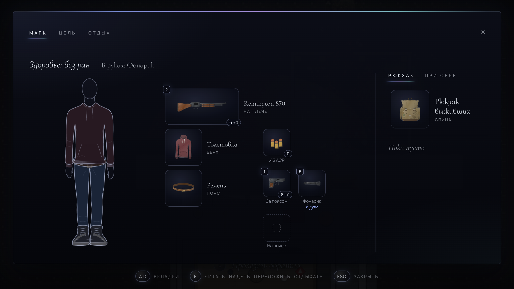

С прошлого поста [концепт-демо](https://play.mirrowick.com/) снова изменилось. Старые сохранения не загрузятся, так что начинать опять придётся заново.

Подземный уровень теперь ведёт дальше. За его краем есть узкий лаз, пробраться через который можно только пригнувшись, а за ним несколько старых комнат, где до Марка кто-то жил. Там темно, и именно там он теперь проводит первую ночь. Лампы в комнатах можно зажечь и снова погасить, а то, что в них осталось, стоит осмотреть.

Теперь важно, во что Марк одет. От одежды зависит, сколько он может держать при себе и где, а остальное несёт рюкзак, если его найти. Рюкзак носят на спине, и его можно снять и оставить на полу со всем, что в нём, пока Марк за ним не вернётся.

Окно Марка переделано вокруг его фигуры. Он нарисован так, как одет, а рядом каждая надетая вещь и места, которые она даёт; пустое место занимается щелчком. Картинки вещей стали крупнее и цветными.

Та же одежда теперь видна на Марке и в самой игре. Его рисуют по частям, как бумажную куклу, так что всё, что он надевает, вплоть до рюкзака за спиной, появляется на нём. Ещё появилась карта: Марк набрасывает её карандашом по ходу дела, и на ней только то, что он видел сам.

За этим стоит много незаметной работы. Каждая вещь нарисована один раз, простым белым силуэтом, и окрашивается в свой цвет, так что у окна и у игры одна и та же картинка. Карту никто не рисует вручную: она строится из самого уровня и меняется вместе с ним. Это по-прежнему концепт, а не игра, и всё ещё может измениться.
