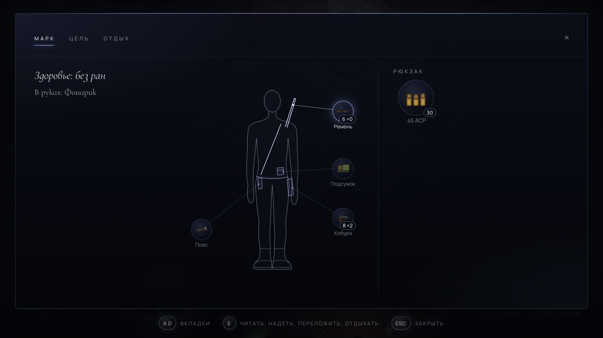
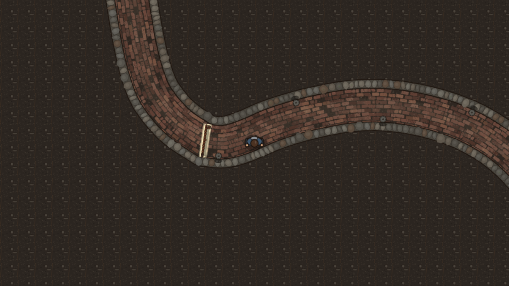
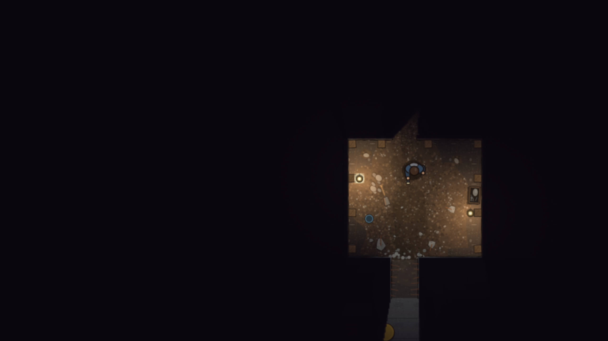

С прошлого поста [концепт-демо](https://play.mirrowick.com/) изменилось сильнее, чем кажется на первый взгляд: у героя появилось состояние, у дня появились часы, а само демо идёт дальше того места, где раньше обрывалось. Это по-прежнему концепт, а не игра.

**Герой**

- По клавише `I` открывается окно Марка. Игра за ним стоит, а вкладок три: «Марк», «Цель» и «Отдых».
- На вкладке «Марк» его фигура, на ней нарисовано то, что он носит и держит под рукой, а рядом рюкзак. Каска и бронежилет видны на герое и в самой игре.
- «Цель» теперь одна, в нескольких строках из того, что он уже знает, так что понятнее, что делать дальше.
- Под рукой длинное оружие, пистолет и фонарик, остальное в рюкзаке. Пока за героем кто-то охотится, до рюкзака не добраться.
- Марк теперь младший брат Виктора, а не племянник. Его мысли появляются над головой.

**Время, еда и сон**

- Время теперь дата и час и идёт в пять раз быстрее нашего. Дела отнимают минуты: обыск шкафчика стоит пяти, и видно, как они уходят.
- На ходу раны не затягиваются. Лечит отдых, от 15 минут до 4 часов, если рядом никого нет.
- Спать можно на койке на уровне −1, в первую ночь со своей сценой. Проснувшись, герой получает точку, откуда начнёт заново, если погибнет.
- После первого сна Марку нужны еда, вода и отдых. Если запас при себе, он ест и пьёт сам. Без них он не умирает, а слабеет, причём жажда, голод и усталость сказываются по-разному.
- Демо теперь кончается в полночь после третьего дня, считая день, когда герой проснулся впервые. Тогда же открывается режим выживания.

**Оружие и вещи**

- Патроны теперь по калибрам. У каждого ствола своя обойма, запасные в подсумках, россыпь в рюкзаке, до которого в бою не дотянуться. Подсумки он набивает сам, когда тихо и оружие убрано.
- С руками у каждого ствола по-своему: пистолет оставляет одну под фонарик, у M4 свой фонарь, а с дробовиком света нет совсем.
- `1` достаёт то, что в кобуре, `2` то, что на ремне.
- Найденное показывается списком: взять или оставить. Марк берёт только то, чему знает применение, а остальное запоминает.

**Сохранение**

- `Esc` теперь ставит игру на паузу и открывает меню.
- Враги, поставленные вручную, остаются мёртвыми, даже если уйти и вернуться; комнаты, которые заполняются врагами, заполняются снова. Раны при выходе из игры сохраняются.
- Старые сохранения не переносятся: демо у всех начнётся заново.

**Места и звук**

- Дом Виктора, двор и мебель теперь в настоящий размер, а дом обставлен как настоящий.
- За дверью в зале подвала появился длинный кирпичный ход в кромешной тьме, до железной решётки, которую намертво прихватила ржавчина.

- Пролом за бочкой на уровне −1 больше не конец демо. За ним укреплённая землянка с керосиновыми лампами, для которых нужна зажигалка, и лаз, где можно пройти только пригнувшись. Куда он ведёт, посмотрите сами.
- Свет теперь останавливается на лицевой стороне стены, а выстрелы, искры и светящиеся враги отбрасывают тени от стен.
- Новая музыка: своя тема на главном экране, ленивый летний день у дома, тишина в подвале и слой для боя, который тем плотнее, чем ближе и больше врагов.

**Как это делалось**

Всё в игре мы перевели в настоящие размеры, на клетку в полметра. Исключение только машины, в них 85%: сверху настоящая машина рядом с настоящим человеком смотрится автобусом. Уровень −1 теперь собирается по единому плану, где каждая комната и каждый проём записаны один раз, а всё в комнате отсчитывается от её стен, так что стены можно двигать, не переписывая числа по всему коду.

Главная сцена игры слишком разрослась, и большая часть из неё переехала: свет, цели, герой, раны, дни и сюжет каждого места теперь живут отдельно, а сцена знает только механики. Все вещи собраны в одном каталоге, по записи на вещь со всем, что о ней известно. Музыка по-прежнему целиком собирается в коде, без звуковых файлов.
