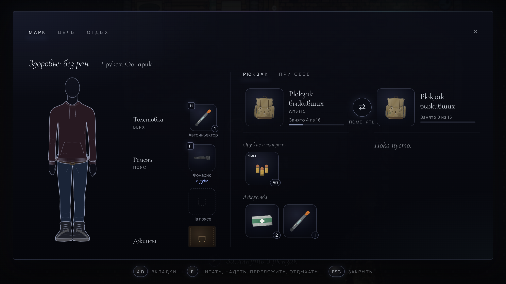

С прошлого поста [концепт-демо](https://play.mirrowick.com/) заметно изменилось. Старые сохранения снова не загрузятся, так что начинать придётся заново.

Больше всего работы ушло на подземный уровень. Теперь его освещает только то, что осталось от аварийного света, и двух одинаковых ламп там нет: одни ярче, другие тусклее, и у каждой свой оттенок. Между ними темнота, и всё, что здесь живёт, держится либо света, либо тьмы. Появились новые существа, и одно из них предпочитает темноту у стен и на свет выходить не любит. На полу пыль, протоптанные дорожки и пятна, а сам уровень теперь можно пройти до конца, где демо и заканчивается.

Марка теперь можно ранить так, что о нём придётся позаботиться: найдутся повязки и другие лекарства, и некоторыми из них можно воспользоваться, только когда бой позади. А если всё кончится хуже, его гибель теперь видна на экране. К первому оружию прилагается короткий урок, как с ним обращаться, а листки с подсказками останавливают игру, пока вы их читаете.

Сильнее всего изменился рюкзак. Каждая вещь занимает в нём место по своему размеру, так что влезает не всё, а то, что внутри, разложено по видам. Рюкзак, найденный на полу, открывается рядом с его собственным: вещи можно перекладывать из одного в другой, а можно и поменять один рюкзак на другой. Так же, рядом с рюкзаком, открываются ящики и шкафчики, и найденное в них видно рядом с тем, что Марк уже несёт.

За этим стоит работа, которой не видно. Мы сделали для себя просмотрщик, который рисует каждое место планом, и страницы, где все существа, всё оружие и все лекарства собраны рядом, чтобы проще было видеть, что у нас есть, и держать это в порядке. Пол никто не рисует вручную: пыль и потёртости раскладываются один раз, по одному правилу, для любого места. А существа научились двигаться по-новому: стаями с вожаками и группами поменьше. Это по-прежнему концепт, а не игра, и всё ещё может измениться.
